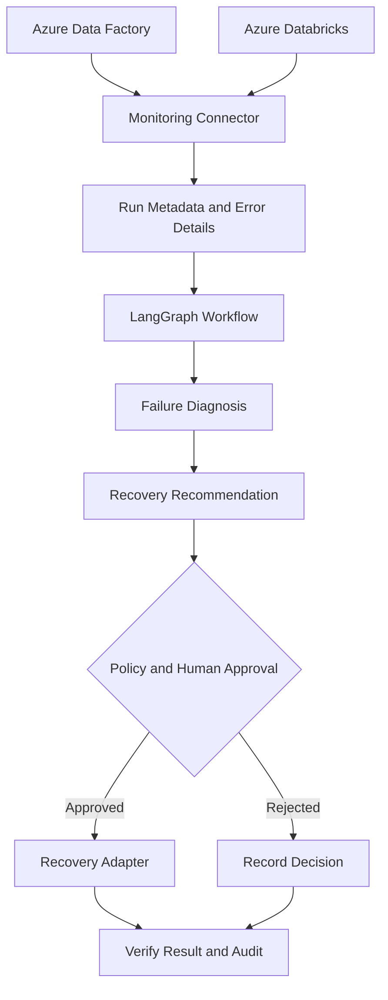

# Self-Healing Data Pipeline Agent

A Python application for monitoring data pipeline runs, investigating failures, and helping operators decide on a safe recovery action. The project is being developed with Azure Data Factory, Azure Databricks, PySpark, and LangGraph in mind.

The current version is a local MVP. It uses sample pipeline-run data to demonstrate the dashboard, basic error classification, retry policy checks, and audit logging. Azure services are not connected yet, and retry actions are simulated.

## Project goals

- Bring pipeline status and failure details into one place.
- Help identify likely causes of common pipeline failures.
- Provide practical, evidence-based troubleshooting recommendations.
- Require approval and safety checks before recovery actions.
- Keep an audit trail of decisions and action outcomes.

## Current status

### Implemented

- Streamlit dashboard with sample successful, failed, and delayed pipeline runs.
- Rule-based diagnosis for schema mismatch, data-quality failures, timeouts, and transient connectivity errors.
- Retry eligibility checks, operator approval input, and a configurable policy function with a retry limit.
- Simulated retry action; no real pipeline is restarted.
- Local JSON Lines audit log for recovery decisions.
- Unit tests for diagnosis and retry-policy behavior.
- Local Windows setup instructions and sample data.

### Not implemented yet

- Live Azure Data Factory API connection.
- Live Databricks job and task monitoring.
- LangGraph agent orchestration or LLM-based diagnosis.
- Automated polling, alerting, or notifications.
- PySpark-based schema drift and data-quality checks against real datasets.
- Production recovery execution, identity-based access controls, and role-based approvals.

The status above reflects the current repository implementation. Planned features should not be treated as available until the relevant integration and tests are added.

## Architecture

The target architecture is:



This is the intended architecture, not a description of integrations already running in the MVP.

## Run locally

Requires Python 3.10 or newer.

From Windows PowerShell, change to the project folder and run:

```powershell
py -m venv .venv
.\.venv\Scripts\Activate.ps1
python -m pip install --upgrade pip
pip install -r requirements.txt
streamlit run app.py
```

If PowerShell blocks virtual-environment activation, run this in the same terminal and try activation again:

```powershell
Set-ExecutionPolicy -Scope Process -ExecutionPolicy Bypass
```

Streamlit will print a local URL to open in your browser.

## Try the current MVP

1. Open the dashboard.
2. Select one of the sample pipeline runs.
3. Review the error and suggested next step.
4. Enter an operator name and review retry eligibility.
5. Record the decision and inspect the audit history.

The sample records are stored in `data/sample_runs.json`. The application writes audit events to `logs/audit.jsonl` when a decision is recorded. These are local demo files, not an enterprise audit store.

## Run tests

```powershell
python -m pytest
```

## Development roadmap

### Phase 1 — Azure Data Factory monitoring

**Objective:** Replace sample run data with live pipeline-run metadata.

- Configure subscription ID, resource group, and Data Factory name.
- Authenticate locally with Azure CLI and `DefaultAzureCredential`; use managed identity when hosted in Azure.
- Add a connector for the Azure Data Factory pipeline-runs query API.
- Display real pipeline status, run ID, start/end time, duration, and available failure details.
- Add clear handling for missing permissions, API errors, and expired credentials.

**Completion criteria:** The dashboard can query a selected Data Factory and display recent real runs using read-only access.

### Phase 2 — Failure and activity diagnostics

**Objective:** Give operators enough context to investigate a failed run.

- Retrieve activity-run details for failed pipelines.
- Normalize error messages and relevant metadata.
- Improve classification for timeouts, authentication errors, schema mismatches, data-quality failures, and transient service errors.
- Show evidence behind each recommendation and distinguish confirmed facts from likely causes.

**Completion criteria:** An operator can select a failed run and view its relevant activity error details and a reasoned troubleshooting suggestion.

### Phase 3 — Databricks monitoring

**Objective:** Include Databricks jobs and tasks in the same operational view.

- Configure the workspace URL and an approved authentication method.
- Use the Databricks SDK or supported APIs to retrieve job-run and task status.
- Link a Data Factory activity to its Databricks run where identifiers are available.
- Show relevant task failures and available error details.

**Completion criteria:** The dashboard can display authorized Databricks job-run information alongside Data Factory runs.

### Phase 4 — LangGraph diagnosis workflow

**Objective:** Coordinate diagnosis as a controlled, testable workflow.

- Add workflow steps for run enrichment, log analysis, diagnosis, and recommendation.
- Use an LLM only where it adds value, grounded in retrieved run metadata and sanitized error details.
- Return structured results: likely cause, supporting evidence, confidence, recommended action, and whether retry is potentially appropriate.
- Handle missing context and model/API failures without blocking basic monitoring.

**Completion criteria:** The workflow produces a structured diagnosis and recommendation that can be reviewed and tested.

### Phase 5 — Data-quality and schema checks

**Objective:** Add data-level evidence for common ETL failures.

- Use PySpark to compare source and target schemas where access is configured.
- Add configurable checks for nulls, duplicates, expected columns, data types, and basic business rules.
- Capture validation summaries without exposing sensitive row-level data.
- Recommend remediation rather than automatically changing source data.

**Completion criteria:** A test dataset can demonstrate schema-drift and data-quality detection with readable results.

### Phase 6 — Controlled recovery and audit

**Objective:** Add recovery actions only after monitoring and diagnosis are reliable.

- Add a policy layer for retry eligibility, attempt limits, backoff, and idempotency checks.
- Require authenticated operator approval for production recovery actions.
- Implement the appropriate Azure recovery adapter and verify the result after execution.
- Record the run ID, requesting operator, approval decision, reason, action, timestamp, and outcome.
- Prevent duplicate or unsafe recovery requests and provide a clear failure path.

**Completion criteria:** An approved test recovery can be executed in a non-production environment, verified, and audited end to end.

### Phase 7 — Scheduled monitoring and deployment

**Objective:** Run checks without keeping a developer's laptop open.

- Add a scheduled worker, such as an Azure Function, to poll runs or process supported monitoring events.
- Configure duration thresholds and alerting for failures and delays.
- Store operational history in an appropriate persistent store if required.
- Add monitoring, tests, deployment configuration, and operational documentation.

**Completion criteria:** The service can run on a schedule, detect configured conditions, and deliver alerts with traceable run references.

## Azure setup notes

For local development, install the Azure CLI, sign in, and select the subscription:

```powershell
az login
az account list --output table
az account set --subscription "YOUR_SUBSCRIPTION_ID"
az account show
```

The planned Data Factory connector will need the subscription ID, resource group, and factory name. The planned Databricks connector will need the workspace URL and access to the relevant jobs. Resource names and IDs should be kept in local configuration or environment variables, not hard-coded into source files.

Azure CLI authentication is intended for local development. For an Azure-hosted service, prefer a managed identity with only the permissions needed for monitoring. Read access should be sufficient for the initial monitoring phases; recovery permissions should be added separately only when the recovery feature is implemented and reviewed.

An example configuration is available in `.env.example`. Do not put passwords, client secrets, access tokens, connection strings, or production logs in Git. Keep real recovery actions disabled until approval, authorization, idempotency, retry limits, and audit requirements are in place.

## Technology stack

- Python
- Streamlit
- Azure Data Factory REST API (planned integration)
- Azure Identity / Microsoft Entra ID (planned integration)
- Azure Databricks SDK (planned integration)
- PySpark (planned data-quality checks)
- LangGraph (planned orchestration)
- pytest

## Contributing

Issues and pull requests are welcome. Please include reproduction steps for bugs and tests for behavior changes. Do not submit credentials, customer data, or production logs.

## License

This project is licensed under the MIT License. See [LICENSE](LICENSE).
