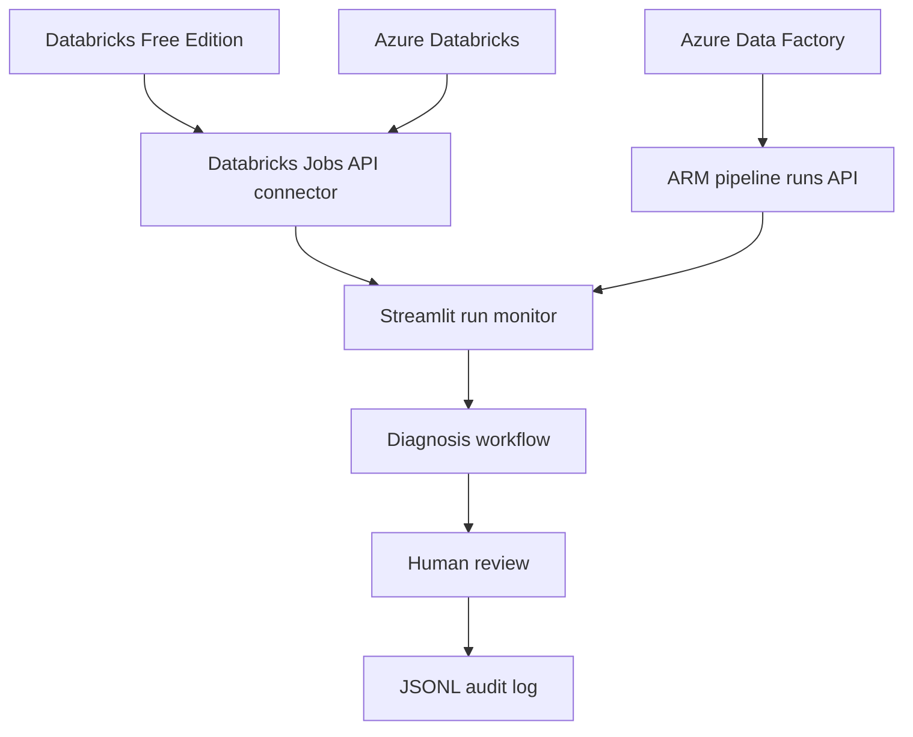

# Self-Healing Data Pipeline Agent

A local-first Python dashboard for monitoring Databricks job runs, classifying common failures, recommending safe next steps, and recording human review decisions. The project supports a demo mode, a Databricks Free Edition configuration, and a planned Azure environment.

## Current implementation

- Streamlit dashboard with sample/demo and live Databricks Jobs API monitoring.
- Separate environment settings for Databricks Free Edition and Azure Databricks.
- Optional Azure Data Factory pipeline-run monitoring through Azure Resource Manager.
- Rule-based failure diagnosis, with an optional LangGraph workflow wrapper.
- JSON Lines audit history for human review.
- Sample PySpark ETL and data-quality job.
- Live recovery is intentionally not implemented in the dashboard yet. The app is read-first and records review decisions only.

## Architecture



## Windows setup

Use Python 3.11 or 3.12.

```powershell
git clone https://github.com/swapniltake1/self-healing-data-pipeline-agent.git
cd self-healing-data-pipeline-agent
py -m venv .venv
.\.venv\Scripts\Activate.ps1
python -m pip install --upgrade pip
pip install -r requirements.txt
Copy-Item .env.example .env
streamlit run app_connected.py
```

If PowerShell blocks activation, run `.\.venv\Scripts\python.exe -m pip install -r requirements.txt` and `.\.venv\Scripts\python.exe -m streamlit run app_connected.py`.

## Configure Databricks Free Edition now

Edit the local `.env` file:

```dotenv
APP_MODE=free
DATABRICKS_FREE_HOST=https://YOUR-WORKSPACE-URL
DATABRICKS_FREE_TOKEN=YOUR_TOKEN
```

Use the workspace URL from your browser. Create a token only if the Free Edition workspace exposes and supports the relevant token/authentication option. Keep the token local; never commit `.env`. The app reads Jobs API 2.2 run metadata. API availability and permissions can vary by workspace/edition; if the endpoint is unsupported or access is denied, the app will show the API error.

## Enable Azure next month

When Azure Databricks is ready, update `.env`:

```dotenv
APP_MODE=azure
AZURE_DATABRICKS_HOST=https://YOUR-WORKSPACE.azuredatabricks.net
AZURE_DATABRICKS_TOKEN=YOUR_AZURE_DATABRICKS_TOKEN
```

To also monitor Azure Data Factory, add:

```dotenv
AZURE_SUBSCRIPTION_ID=YOUR_SUBSCRIPTION_ID
AZURE_RESOURCE_GROUP=YOUR_RESOURCE_GROUP
AZURE_DATA_FACTORY_NAME=YOUR_FACTORY_NAME
```

For Data Factory, the recommended local authentication path is Azure CLI. Install Azure CLI and sign in with `az login`; the connector uses Azure Identity to request an ARM token. `AZURE_ACCESS_TOKEN` is optional for short-lived local testing only and should not be committed. The signed-in identity needs permission to read pipeline runs in the Data Factory resource.

After editing `.env`, restart Streamlit. Choose exactly one `APP_MODE`: `demo`, `free`, or `azure`. Azure mode can show both Azure Databricks runs and ADF runs if the ADF settings are present.

## Run tests

```powershell
pytest -q
```

## Security and safety

- `.env`, credentials, and audit logs are excluded from Git.
- Start with read-only monitoring and least-privilege permissions.
- Diagnosis output is a recommendation, not proof of root cause.
- No live pipeline restart or repair is performed by the current dashboard.
- Review idempotency, access controls, approval flows, and audit retention before implementing recovery.

## Roadmap

1. Validate Free Edition API access and pagination in your workspace.
2. Add deeper run/task error retrieval and better root-cause evidence.
3. Add Azure Data Factory activity-run details.
4. Design approval-gated recovery with explicit retry budgets and idempotency safeguards.
5. Add integration tests with mocked API responses and deployment documentation.

## License

MIT. See [LICENSE](LICENSE).
