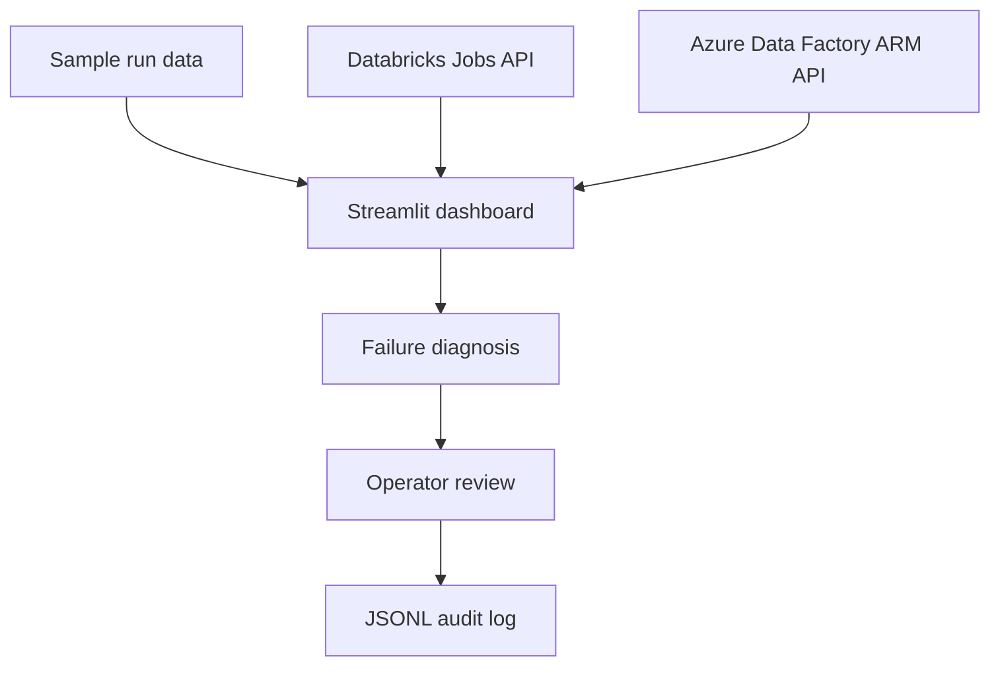

# DataPipelineIntelligence

An AI-assisted data pipeline monitoring and reliability platform built with Python and Streamlit. DataPipelineIntelligence helps teams inspect pipeline runs, diagnose common failures, and record operator review decisions. It supports a local demo mode, Databricks Free Edition configuration, and Azure Databricks with optional Azure Data Factory monitoring.

The current implementation is **read-only**: it can retrieve run metadata, display likely causes and recommended next steps, and record a review in an audit log. It does **not** restart jobs or repair pipelines automatically.

## Features

- **Demo mode:** view synthetic runs from `data/sample_runs.json` without cloud credentials.
- **Databricks monitoring:** retrieve recent job-run metadata through the Databricks Jobs API.
- **Azure Data Factory monitoring:** optionally retrieve recent pipeline runs through the Azure Resource Manager API.
- **Failure diagnosis:** rule-based diagnosis with a LangGraph workflow wrapper.
- **Human review:** record the operator name and whether the diagnosis was reviewed.
- **Audit trail:** append review events as JSON Lines to a configurable local file.
- **Sample ETL:** `jobs/sample_etl.py` demonstrates a PySpark ETL/data-quality job.
- **Environment-based configuration:** select `demo`, `free`, or `azure` through a local `.env` file.

## Architecture



## Requirements

- Python 3.11 or 3.12 recommended
- Git
- For live Databricks monitoring: a workspace URL and supported API credentials
- For Azure Data Factory monitoring: an Azure subscription, resource group, factory name, and an identity permitted to read pipeline runs
- Azure CLI for the recommended local Azure authentication flow

## Windows setup

Open PowerShell and run:

```powershell
git clone https://github.com/swapniltake1/DataPipelineIntelligence.git
cd DataPipelineIntelligence

py -m venv .venv
.\.venv\Scripts\Activate.ps1

python -m pip install --upgrade pip
pip install -r requirements.txt

Copy-Item .env.example .env
streamlit run app.py
```

If PowerShell blocks virtual-environment activation, use the environment's executables directly:

```powershell
.\.venv\Scripts\python.exe -m pip install -r requirements.txt
.\.venv\Scripts\python.exe -m streamlit run app.py
```

Open the local URL printed by Streamlit in your browser.

## Configure the application

The application reads configuration from `.env` at the repository root. Copy `.env.example` to `.env`, then set the appropriate values. After changing configuration, restart Streamlit.

### 1. Demo mode

Use demo mode to explore the dashboard without cloud credentials:

```dotenv
APP_MODE=demo
```

Demo mode loads synthetic data from `data/sample_runs.json`. It does not connect to Databricks or Azure.

### 2. Databricks Free Edition

Set the mode and your workspace credentials in the local `.env` file:

```dotenv
APP_MODE=free
DATABRICKS_FREE_HOST=https://YOUR-WORKSPACE-URL
DATABRICKS_FREE_TOKEN=YOUR_TOKEN
```

Use your actual workspace URL. Generate a token only if your workspace and edition expose and support the authentication method required by the API. The connector calls the Databricks Jobs API 2.2 to retrieve recent run metadata.

**Free Edition compatibility is not guaranteed.** API access, token support, permissions, and available job features can vary. If a request fails, the dashboard displays the API error; confirm the endpoint and authentication options supported by your workspace.

### 3. Azure Databricks and Azure Data Factory

For Azure Databricks, set:

```dotenv
APP_MODE=azure
AZURE_DATABRICKS_HOST=https://YOUR-WORKSPACE.azuredatabricks.net
AZURE_DATABRICKS_TOKEN=YOUR_AZURE_DATABRICKS_TOKEN
```

To include Azure Data Factory pipeline runs, also set:

```dotenv
AZURE_SUBSCRIPTION_ID=YOUR_SUBSCRIPTION_ID
AZURE_RESOURCE_GROUP=YOUR_RESOURCE_GROUP
AZURE_DATA_FACTORY_NAME=YOUR_FACTORY_NAME
AZURE_MANAGEMENT_API_VERSION=2018-06-01
```

The recommended local authentication method for Data Factory is Azure CLI:

```powershell
az login
```

The connector uses Azure Identity to request an Azure Resource Manager token. The signed-in identity must have permission to read pipeline runs for the configured factory. `AZURE_ACCESS_TOKEN` is an optional override for short-lived testing; avoid storing long-lived credentials in files.

In `azure` mode, the app monitors Azure Databricks and also queries Azure Data Factory when all three ADF settings (subscription, resource group, and factory name) are configured.

### Configuration reference

| Variable | Purpose |
|---|---|
| `APP_MODE` | `demo`, `free`, or `azure`; defaults to `demo` |
| `DATABRICKS_FREE_HOST` | Databricks Free Edition workspace URL |
| `DATABRICKS_FREE_TOKEN` | Token for the Free Edition workspace, if supported |
| `AZURE_DATABRICKS_HOST` | Azure Databricks workspace URL |
| `AZURE_DATABRICKS_TOKEN` | Azure Databricks API token |
| `DATABRICKS_HOST`, `DATABRICKS_TOKEN` | Optional generic fallback credentials |
| `AZURE_SUBSCRIPTION_ID` | Azure subscription containing the Data Factory |
| `AZURE_RESOURCE_GROUP` | Resource group containing the Data Factory |
| `AZURE_DATA_FACTORY_NAME` | Data Factory resource name |
| `AZURE_ACCESS_TOKEN` | Optional Azure ARM bearer-token override |
| `AZURE_MANAGEMENT_API_VERSION` | ARM API version; defaults to `2018-06-01` |
| `REQUEST_TIMEOUT_SECONDS` | HTTP timeout in seconds; defaults to `20` |
| `AUDIT_LOG_PATH` | Local audit-log path; defaults to `logs/audit.jsonl` |
| `ENABLE_LIVE_RECOVERY` | Reserved safety setting; live recovery is not implemented |
| `MAX_AUTOMATIC_RETRIES` | Reserved safety setting; automatic retries are not implemented |

Keep credentials in your local `.env`; never commit them.

## Use the dashboard

1. Start the app with `streamlit run app.py`.
2. Choose demo mode or configure the relevant live connection in `.env`.
3. Review the run table and summary metrics.
4. Select a run to see its diagnosis category, likely cause, and recommendation.
5. Enter an operator name, mark whether you reviewed the diagnosis, and click **Record review** to append an audit event.

A review event records the run identifier, pipeline/source, operator, review checkbox, diagnosis category, and the fact that no live recovery action was executed. The log path is controlled by `AUDIT_LOG_PATH`.

## Run tests

From the repository root:

```powershell
pytest -q
```

These tests are intended to validate local logic and connector behavior. They do not verify access to your real Databricks workspace or Azure subscription; live integration should be tested separately with appropriately scoped credentials.

## Current limitations and safety

- The dashboard is **read-only for cloud systems**. It does not trigger job reruns, restart pipelines, or apply repairs.
- Diagnosis is a best-effort recommendation based on available run/error metadata, not a confirmed root cause.
- Databricks task-level error messages may be missing or incomplete depending on the API response and permissions.
- Azure Data Factory monitoring is limited to recent pipeline-run metadata; detailed activity-run analysis is not yet implemented.
- Cloud API support and authentication can differ by workspace, tenant, and edition.
- `ENABLE_LIVE_RECOVERY` and `MAX_AUTOMATIC_RETRIES` are safety/configuration placeholders, not evidence that recovery is available.

Use least-privilege credentials, keep secrets out of source control, and review audit-log retention before using the project with production data.

## Roadmap

1. Validate Databricks Free Edition API access and pagination against the target workspace.
2. Improve retrieval of task-level and pipeline activity error details.
3. Add mocked integration tests for success, authorization failures, timeouts, and malformed responses.
4. Design approval-gated recovery with idempotency checks, retry limits, and a clear rollback strategy.
5. Document deployment and production operations after cloud integrations have been validated.

## License

MIT. See [LICENSE](LICENSE).
