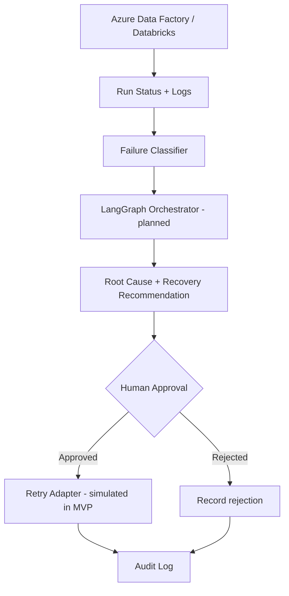

<<<<<<< HEAD
# Self-Healing Data Pipeline Agent

An initial, local-first starter project for monitoring ETL pipeline runs, diagnosing common failures, recommending safe recovery actions, and recording approval/audit events.

## MVP capabilities

- Demo pipeline run dashboard with failed, delayed, and successful runs.
- Rule-based root-cause hints for schema mismatch, data-quality failures, timeout, and transient errors.
- Human approval gate before a retry is requested.
- Append-only local JSONL audit log.
- Streamlit UI using synthetic demo data.
- Clear integration points for Azure Data Factory, Azure Databricks, PySpark, and LangGraph.

> **Safety note:** The included retry action is a simulation only. It does not call Azure or restart real jobs. Keep production recovery behind authentication, least-privilege identities, idempotency checks, approval policies, and auditable controls.

## Architecture



## Quick start (Windows PowerShell)

```powershell
py -m venv .venv
.\.venv\Scripts\Activate.ps1
python -m pip install --upgrade pip
pip install -r requirements.txt
streamlit run app.py
```

If PowerShell blocks activation, run `Set-ExecutionPolicy -Scope Process -ExecutionPolicy Bypass` in that terminal, then activate again.

## Project structure

```text
self-healing-data-pipeline-agent/
├── app.py
├── requirements.txt
├── .env.example
├── .gitignore
├── src/
│   ├── __init__.py
│   ├── diagnosis.py
│   ├── audit.py
│   └── recovery.py
├── tests/
│   └── test_diagnosis.py
└── data/
    └── sample_runs.json
```

## Current MVP flow

1. Select a synthetic pipeline run.
2. Review the classifier's likely cause and suggested action.
3. Enter an operator name and approve or reject the simulated retry.
4. The decision is appended to `logs/audit.jsonl`.

The diagnosis is heuristic-based in this first commit; it is not an LLM-generated or production-grade diagnosis.

## Next milestones

1. Add LangGraph nodes for log normalization, diagnosis, policy validation, approval, and action planning.
2. Integrate Azure Data Factory monitoring APIs using Microsoft Entra ID / managed identity.
3. Retrieve Databricks job run state and bounded, redacted error logs.
4. Add data-quality checks and schema-drift comparison using PySpark.
5. Add authentication, role-based approvals, retry limits, idempotency controls, and automated tests.
6. Add deployment configuration only after secrets and identity are configured securely.

## Configuration

Copy `.env.example` to `.env` only when you begin Azure integration. Never commit credentials, tokens, connection strings, or real production logs.

## License

MIT License. See `LICENSE`.
=======
# self-healing-data-pipeline-agent
AI-powered data pipeline monitoring, failure diagnosis, and safe recovery using Python, PySpark, Azure Data Factory, Databricks, and LangGraph.
>>>>>>> 140f0b9f9bd905a1f7d9fac6cd4e871058c2fe0e
